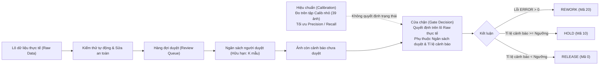
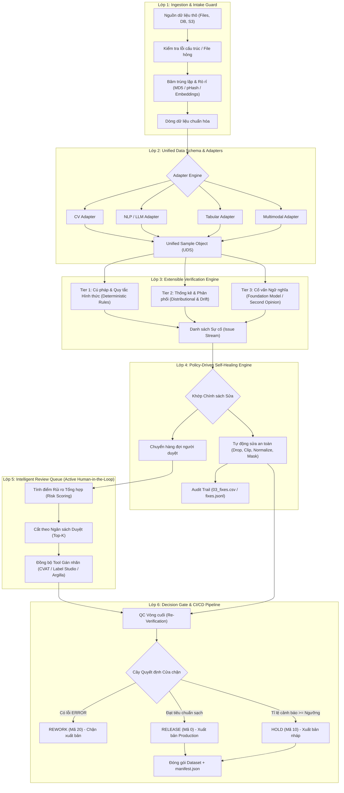
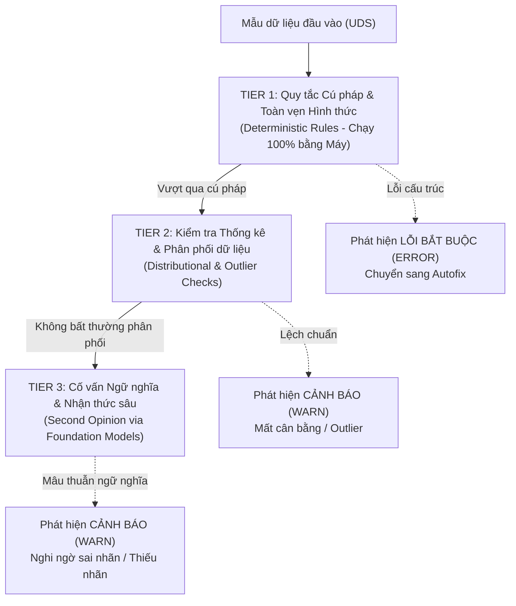
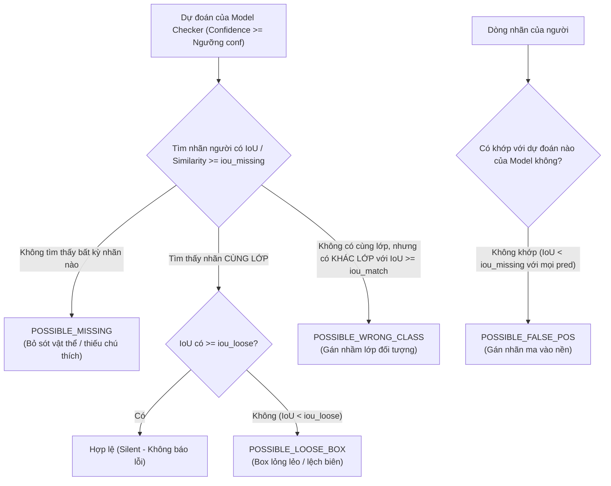
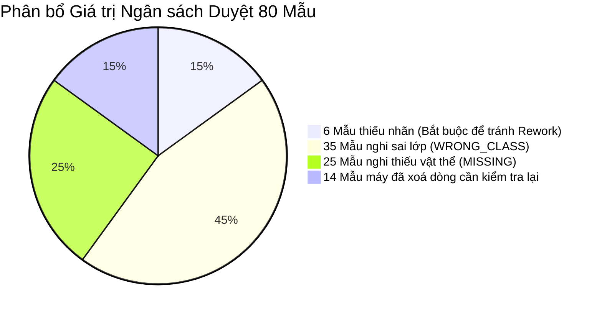
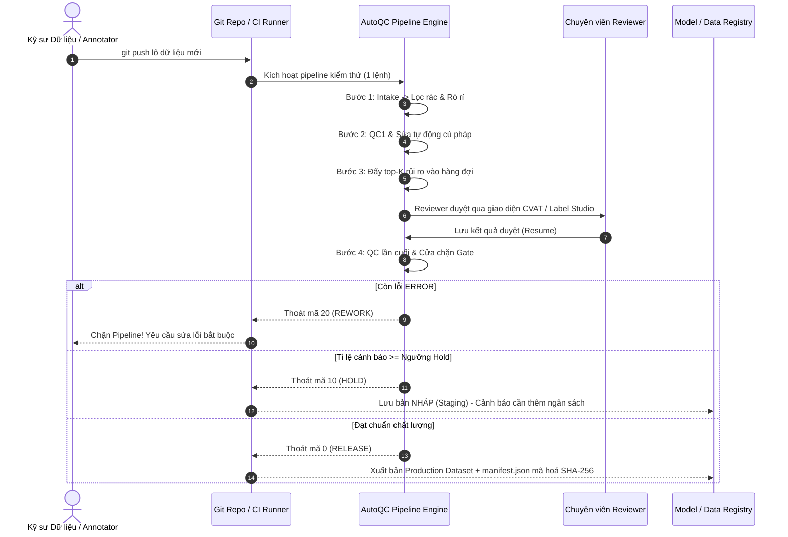

# BÁO CÁO NGHIÊN CỨU & KIẾN TRÚC KỸ THUẬT: HỆ THỐNG KIỂM THỬ TỰ ĐỘNG VÀ TỰ ĐỘNG SỬA CHỮA DỮ LIỆU ĐA NĂNG (UNIVERSAL AUTOQC & SELF-HEALING DATA FRAMEWORK)

> **Tác giả**: Đội ngũ Kỹ thuật & Nghiên cứu MLOps / Data-Centric AI  
> **Phiên bản kiến trúc**: v2.4 (Enterprise & Framework-Agnostic Edition)  
> **Tài liệu tham chiếu nền tảng**: Kiến trúc Pipeline AutoQC Day 09 & Cơ chế Cửa chặn Chất lượng Dữ liệu (Release / Hold / Rework)

---

## TỔNG QUAN ĐIỀU HÀNH (EXECUTIVE SUMMARY)

Trong kỷ nguyên **Data-Centric AI**, chất lượng của tập dữ liệu huấn luyện quyết định trực tiếp tới 80% độ chính xác, tính ổn định và độ an toàn của các hệ thống trí tuệ nhân tạo trong môi trường sản xuất. Tuy nhiên, phần lớn các tổ chức hiện nay vẫn đang đối mặt với những thách thức nghiêm trọng:
1. **Quy trình kiểm thử thủ công tốn kém**: Phụ thuộc nặng nề vào con người để duyệt nhãn, gây chậm trễ tiến độ (bottleneck) và chi phí vận hành khổng lồ.
2. **Công cụ phân mảnh và thiếu tính tái sử dụng**: Mỗi bài toán (Computer Vision, NLP, Tabular) lại xây dựng một script kiểm tra riêng lẻ, không có chuẩn chung, không thể chuyển giao hay tái sử dụng qua các dự án khác.
3. **Thiếu khả năng tự chữa lành an toàn (Self-Healing)**: Các lỗi cú pháp, tràn biên, định dạng sai thường bị xoá bỏ hàng loạt làm mất mát dữ liệu quý giá, hoặc sửa đổi thủ công không có nhật ký truy vết (audit trail), gây mất kiểm soát phiên bản dữ liệu.
4. **Không có cửa chặn định lượng (Quality Gate)**: Dữ liệu bẩn dễ dàng rò rỉ vào quá trình huấn luyện mà không có cảnh báo rõ ràng.

Báo cáo này nghiên cứu và đề xuất thiết kế **Hệ thống Kiểm thử Tự động & Tự động Sửa chữa Dữ liệu Phổ quát (Universal AutoQC & Self-Healing Framework)**. Được nâng tầm từ các bài học thực chiến của pipeline Day 09, hệ thống được chuẩn hóa để có thể **chuyển đổi nhanh chóng chỉ trong 15 phút** cho bất kỳ loại dữ liệu nào (Thị giác máy tính, Xử lý ngôn ngữ tự nhiên/LLM, Dữ liệu bảng tài chính, hay Dữ liệu đa phương thức) với độ tin cậy tuyệt đối.

---

## PHẦN 1: BÀI HỌC CỐT LÕI TỪ THỰC NGHIỆM DAY 09 & TẦM NHÌN PHỔ QUÁT

### 1.1. Giải mã nghịch lý: "Vì sao lô dữ liệu vẫn ra HOLD dù đã Calibrate?"

Từ tài liệu phân tích thực nghiệm của Day 09, ta rút ra một nguyên lý mang tính nền tảng của kỹ thuật dữ liệu:



#### Hai bài toán hoàn toàn tách biệt:
1. **Calibration (Hiệu chuẩn)** giải quyết câu hỏi: *"Bộ kiểm tra (Checker) có nhận diện chính xác các lỗi đã biết mà không sinh ra quá nhiều cảnh báo giả hay không?"*
   - Mục tiêu: Tìm điểm cân bằng tối ưu giữa **Precision** và **Recall** trên một tập dữ liệu mẫu chuẩn hóa có đáp án (`data/calib/`).
2. **Cửa chặn (Gate)** giải quyết câu hỏi: *"Sau khi con người đã dồn toàn lực xem xét trong phạm vi ngân sách cho phép, mức độ rủi ro còn lại của lô dữ liệu này có đủ an toàn để đưa vào huấn luyện mô hình hay không?"*

#### Bản chất của trạng thái HOLD:
- Giả sử một lô dữ liệu có $N = 203$ mẫu hợp lệ sau bước tiếp nhận.
- Động cơ QC phát hiện $130$ mẫu có cảnh báo ngữ nghĩa (`WARN`).
- Ngân sách của chuyên viên gán nhãn chỉ đủ duyệt $K = 80$ mẫu nguy cơ cao nhất.
- Số mẫu còn lại mang cảnh báo chưa được kiểm định là: $N_{\text{warn}} = 130 - 80 = 50$ mẫu.
- Tỉ lệ cảnh báo thực tế còn lại:
  $$\text{Warn\_Ratio} = \frac{N_{\text{warn}}}{N} = \frac{50}{203} \approx 24.6\%$$
- Do ngưỡng an toàn quy định của dự án là $\tau_{\text{hold}} = 10\%$, hệ thống **bắt buộc phải trả về HOLD (Mã thoát 10)**.

> **Bài học cốt lõi**: Calibration giúp ta **không bị mù quáng** bởi các cảnh báo rác, nhưng nếu dữ liệu đầu vào vốn dĩ quá nhiều vấn đề hoặc ngân sách con người quá eo hẹp, hệ thống kiểm thử trung thực phải báo **HOLD** để ngăn chặn việc đưa dữ liệu rủi ro cao vào dây chuyền sản xuất.

---

## PHẦN 2: KIẾN TRÚC TỔNG THỂ HỆ THỐNG 6 LỚP (UNIVERSAL 6-LAYER ARCHITECTURE)

Để áp dụng linh hoạt cho mọi loại dữ liệu và mọi dự án, hệ thống được thiết kế theo mô hình **6 lớp tách biệt (Decoupled Layered Architecture)**:



---

## PHẦN 3: LỚP TRỪU TƯỢNG HÓA DỮ LIỆU (UNIFIED DATA SCHEMA & ADAPTER PATTERN)

Chìa khóa để công cụ có thể chuyển đổi nhanh giữa các dự án mà không cần viết lại toàn bộ pipeline là **Lược đồ dữ liệu hợp nhất (Unified Data Schema - UDS)** kết hợp mẫu thiết kế **Adapter Pattern**.

### 3.1. Cấu trúc Lược đồ Hợp nhất (UDS)
Mọi đối tượng dữ liệu trong thế giới thực đều được trừu tượng hóa về 4 cấu trúc dữ liệu cốt lõi:

```python
from dataclasses import dataclass, field
from enum import Enum
from typing import Any, Dict, List, Optional

class Severity(str, Enum):
    ERROR = "error"  # Lỗi bắt buộc: Vi phạm cú pháp, rò rỉ dữ liệu -> Chặn pipeline
    WARN = "warn"    # Cảnh báo ngữ nghĩa: Nghi ngờ sai lệch, box lỏng, mất cân bằng -> Chuyển người

@dataclass
class AnnotationUnit:
    """Đơn vị gán nhãn đơn lẻ (Bounding box, Token span, Phân loại, v.v.)"""
    id: str
    category: str
    geometry: Optional[Dict[str, Any]] = None  # Toạ độ [cx, cy, w, h], đa giác, hoặc start_token:end_token
    confidence: Optional[float] = None
    attributes: Dict[str, Any] = field(default_factory=dict)
    raw_reference: Optional[str] = None       # Dòng file gốc, vị trí ký tự để phục vụ sửa đổi

@dataclass
class UnifiedSample:
    """Mẫu dữ liệu chuẩn hóa độc lập với loại dữ liệu cụ thể"""
    sample_id: str
    modality: str  # 'vision', 'nlp', 'tabular', 'multimodal'
    data_payload: Any  # Đường dẫn file ảnh/âm thanh, hoặc chuỗi văn bản, hoặc dict thuộc tính
    annotations: List[AnnotationUnit] = field(default_factory=list)
    metadata: Dict[str, Any] = field(default_factory=dict)

@dataclass
class Issue:
    """Báo cáo sự cố chuẩn hóa"""
    check_name: str
    severity: Severity
    code: str
    sample_id: str
    message: str
    target_unit_id: Optional[str] = None
    line_number: Optional[int] = None
    extra_context: Dict[str, Any] = field(default_factory=dict)
```

### 3.2. Bảng ma trận ánh xạ Adapter cho các loại dữ liệu

| Loại dữ liệu | Dữ liệu thô (`data_payload`) | Cấu trúc gán nhãn (`AnnotationUnit`) | Các lỗi điển hình cần kiểm tra |
|---|---|---|---|
| **Computer Vision (YOLO/COCO)** | Ảnh JPEG, PNG, TIFF | Bounding box $(cx, cy, w, h)$, lớp đối tượng | Tràn biên $[0, 1]$, diện tích $\le 0$, IoU trùng lặp, thiếu nhãn, nhầm lớp xe/bus |
| **CV Segmentation** | Ảnh JPEG, PNG, MASK PNG | Tọa độ đa giác $(x_1, y_1, ..., x_n, y_n)$ | Đa giác tự cắt chính nó, số điểm $< 3$, diện tích mask quá nhỏ |
| **NLP - Instruction Tuning** | Chuỗi hội thoại Prompt/Response | Cặp nhãn vai trò `system`, `user`, `assistant` | Prompt rỗng, response bị cắt cụt, lặp từ vô hạn (repetition loop), rò rỉ prompt injection |
| **NLP - Named Entity Recognition (NER)** | Văn bản thô, danh sách Tokens | Token spans $(start, end, label)$ | Spans chồng lấn vô lý, ký tự lệch boundary từ vựng, nhãn I- không có B- tiền nhiệm |
| **Tabular / FinTech** | Vector thuộc tính, bản ghi CSV | Nhãn nhị phân/đa lớp (e.g. `is_fraud`) | Giá trị ngoại lai 5-sigma, rò rỉ thời gian (future leakage), mâu thuẫn logic nghiệp vụ |
| **Multimodal (VQA)** | Cặp `(Ảnh, Câu hỏi)` | Chuỗi câu trả lời + Bounding box căn cứ | Câu trả lời mâu thuẫn hình ảnh, hallucination, câu hỏi không liên quan tới ảnh |

---

## PHẦN 4: ĐỘNG CƠ KIỂM THỬ ĐA TẦNG (MULTI-TIER EXTENSIBLE VERIFICATION ENGINE)

Hệ thống phân cấp các quy tắc kiểm tra thành 3 tầng rõ rệt:



### 4.1. TIER 1: Cú pháp & Quy tắc Hình thức (Deterministic Rules)
Đặc điểm: **Chạy siêu nhanh, chính xác 100%, không cần suy diễn AI**.
- **Độ toàn vẹn file**: Kiểm tra file hỏng bằng `Image.open().load()` (với ảnh), giải mã UTF-8 hợp lệ (với văn bản), phân tích JSON/YAML không lỗi ngữ pháp.
- **Biên giới hình học / phạm vi**: Box phải nằm trong $[0, 1]$; giá trị số không được chứa `NaN`, `Inf` hoặc vượt khoảng min/max của domain.
- **Toàn vẹn quan hệ (Relational Integrity)**: Kiểm tra ảnh có file nhãn tương ứng hay không (`MISSING_LABEL_FILE`); kiểm tra ID lớp có nằm trong bảng định nghĩa `classes` hay không.
- **Băm chống trùng lặp & Rò rỉ**:
  - Dữ liệu byte: Băm MD5 / SHA-256 bắt trùng lặp 100%.
  - Dữ liệu hình ảnh: Perceptual Hash (pHash) với khoảng cách Hamming tối ưu để bắt ảnh bị resize, crop nhẹ, nén JPEG.
  - Dữ liệu văn bản: MinHash / SimHash hoặc Vector Embedding Cosine Similarity ($> 0.95$) để bắt bài báo, câu lệnh bị đạo văn/trùng lắp.
  - **Chống rò rỉ dữ liệu (Data Leakage Guard)**: Bắt buộc đối chiếu với kho dữ liệu kiểm thử độc lập (`test_reference_dirs`). Mọi mẫu trùng khớp đều bị đánh mã `LEAK_TEST` và loại bỏ tức khắc.

### 4.2. TIER 2: Thống kê & Phân phối (Statistical & Distributional QC)
Đặc điểm: **Phát hiện những bất thường ở quy mô tập hợp dữ liệu**.
- **Chỉ số mất cân bằng lớp (Class Imbalance Index)**:
  Sử dụng độ hỗn loạn Entropy chuẩn hóa để phát hiện sự biến mất của các lớp hiếm:
  $$H_{\text{norm}} = -\frac{1}{\ln(C)} \sum_{c=1}^{C} p_c \ln(p_c)$$
  Nếu một lớp có tỉ lệ xuất hiện $< 1\%$, hệ thống cờ `CLASS_RARE` để cảnh báo rủi ro mô hình không học được.
- **Phát hiện trôi dạt dữ liệu (Population Stability Index - PSI)**:
  So sánh phân phối thuộc tính của lô dữ liệu mới so với tập dữ liệu cơ sở:
  $$\text{PSI} = \sum_{b=1}^{B} \left( P_b - Q_b \right) \times \ln\left(\frac{P_b}{Q_b}\right)$$
  - $\text{PSI} < 0.1$: Phân phối ổn định.
  - $0.1 \le \text{PSI} \le 0.25$: Cảnh báo biến động nhẹ (`WARN`).
  - $\text{PSI} > 0.25$: Trôi dạt dữ liệu nghiêm trọng, yêu cầu thẩm định lại quy trình thu thập.

### 4.3. TIER 3: Cố vấn Ngữ nghĩa (Second Opinion via Foundation Models)
Đặc điểm: **Dùng mô hình nền tảng mạnh mẽ hơn để soi lại nhãn con người**.
- **Nguyên tắc vàng**: Foundation Model **CHỈ ĐƯA RA CẢNH BÁO (WARN)**, không bao giờ được phép tự tiện ghi đè lên nhãn của con người mà không có sự kiểm chứng.
- **Cơ chế so khớp 4 trạng thái (Semantic Discrepancy Matrix)**:



---

## PHẦN 5: ĐỘNG CƠ TỰ SỬA CHỮA AN TOÀN (SELF-HEALING & IMMUTABLE AUDIT TRAIL)

Một công cụ kiểm thử hiện đại không chỉ dừng lại ở việc lập danh sách lỗi, mà phải có khả năng **chữa lành tự động (Self-Healing)** với những lỗi mà máy có thể khắc phục an toàn.

### 5.1. Bảng quy chuẩn Chính sách Tự sửa chữa (Fix Policy Registry)

| Loại lỗi phát hiện | Mức độ | Hành động tự sửa (`action`) | Bản chất thao tác kỹ thuật | Trạng thái sau sửa |
|---|---|---|---|---|
| `DUP_IMAGE_*`, `LEAK_TEST`, `CORRUPT_IMAGE` | ERROR | `remove_sample` | Xoá mẫu hỏng/trùng khỏi thư mục làm việc | File bị loại bỏ |
| `BAD_CLASS_NAME` | ERROR | `normalize_class_names` | Ánh xạ lại tên lớp theo từ điển chuẩn (`alias`) | File metadata được chuẩn hoá |
| `BAD_FORMAT`, `BAD_CLASS_ID`, `BOX_ZERO` | ERROR | `drop_annotation_line` | Xoá bỏ dòng nhãn vô nghĩa hoặc sai định dạng | Dòng lỗi bị loại trừ |
| `BOX_OUT_OF_IMAGE` | ERROR | `clip_geometry` | Cắt mép box về trong phạm vi giới hạn $[0, 1]$ | Tọa độ chuẩn xác |
| `BOX_OUT_OF_IMAGE` (nằm hẳn ngoài ảnh) | ERROR | `drop_annotation_line` | Nếu sau khi cắt diện tích $\le 0$, tự chuyển sang xoá dòng | Dòng lỗi bị loại trừ |
| `DUP_BOX` | ERROR | `drop_annotation_line` | Xoá dòng xuất hiện sau có IoU trùng lặp $> 0.9$ | Giữ lại 1 box duy nhất |
| `MISSING_LABEL_FILE` | ERROR | `flag_needs_label` | **KHÔNG tạo file rỗng**; ghi nhận để đẩy lên đầu hàng đợi người gán | Chờ người gán |
| `TEXT_HTML_TAGS` / `WHITESPACE` | ERROR/WARN | `sanitize_text` | Làm sạch chuỗi, gỡ mã HTML, chuẩn hoá Unicode NFC | Chuỗi văn bản sạch |
| Mọi cảnh báo ngữ nghĩa (`WARN`) | WARN | `route_to_human_queue` | Giữ nguyên dữ liệu, chuyển người thẩm định | Chờ duyệt |

### 5.2. Giải quyết xung đột lỗi đồng thời (Conflict Resolution Protocol)

Trong thực tế, một dòng hoặc một mẫu dữ liệu có thể kích hoạt nhiều mã lỗi cùng lúc. Hệ thống áp dụng **Cây ưu tiên giải quyết xung đột (Precedence Hierarchy)**:

```
ƯU TIÊN 1: remove_sample (Xoá cả mẫu)
   └── Nếu mẫu bị xoá, bỏ qua toàn bộ việc kiểm tra các dòng chi tiết bên trong.

ƯU TIÊN 2: drop_annotation_line (Xoá dòng/nhãn)
   └── Nếu một dòng vừa bị tràn biên (BOX_OUT_OF_IMAGE) vừa bị trùng lặp (DUP_BOX) hoặc sai ID:
       Lệnh XOÁ DÒNG phải thắng. Không thực hiện cắt biên (clip) trên dòng chuẩn bị bị xoá.

ƯU TIÊN 3: clip_geometry / sanitize_text (Chỉnh sửa nội dung)
   └── Chỉ thực thi khi dòng đó hoàn toàn hợp lệ về cú pháp và không thuộc diện bị loại bỏ.
```

### 5.3. Nhật ký truy vết bất biến (Audit Trail & Idempotency)
- **Nguyên tắc Bất biến (Immutability)**: Không bao giờ chỉnh sửa trực tiếp trên thư mục dữ liệu gốc (`data/raw`). Mọi thao tác sửa chữa diễn ra trên workspace trung gian (`work/run/ds/`).
- **File bằng chứng `03_fixes.csv` (hoặc `fixes.jsonl`)**: Mỗi hành động sửa chữa của máy bắt buộc phải tạo một bản ghi gồm:
  ```json
  {
    "timestamp": "2026-11-18T17:29:24Z",
    "sample_id": "img_0030",
    "target_line": 9,
    "action": "clip_box",
    "before": "1 0.9500 0.5000 0.2000 0.3000",
    "after": "1 0.9250 0.5000 0.1500 0.3000",
    "rule_applied": "cfg.label_format.overflow_tol",
    "operator": "auto_engine"
  }
  ```
- **Tính lũy tiến (Idempotent)**: Chạy pipeline lần thứ 2 trên tập dữ liệu đã sửa phải sinh ra 0 thay đổi mới (ngoại trừ các mẫu `needs_label` đang chờ người).

---

## PHẦN 6: ĐIỀU PHỐI CON NGƯỜI THÔNG MINH (ACTIVE HUMAN-IN-THE-LOOP & RISK SCORING)

Con người là nguồn tài nguyên đắt đỏ nhất trong quy trình xử lý dữ liệu. Hệ thống tối ưu hóa sự can thiệp của con người thông qua **Hàm chấm điểm rủi ro đa tiêu chí (Multi-Criteria Risk Scoring Function)**:

### 6.1. Công thức Tính điểm Rủi ro Tổng hợp
Với mỗi mẫu dữ liệu $x$, điểm ưu tiên đưa vào hàng đợi duyệt được tính toán như sau:

$$\text{RiskScore}(x) = \sum_{i \in \text{Issues}(x)} W(\text{code}_i) \cdot \left(1 + \text{Confidence}_i\right) \cdot \beta(\text{ClassRarity})$$

Trong đó:
- $W(\text{code}_i)$: Trọng số rủi ro của từng mã lỗi quy định trong cấu hình:
  - `NEEDS_LABEL`: Trọng số $10.0$ (Mức khẩn cấp tối đa, nếu không gán pipeline sẽ rơi vào Rework).
  - `POSSIBLE_WRONG_CLASS`: Trọng số $3.0$ (Nguy cơ gây hại mô hình cao nhất trong nhóm cảnh báo).
  - `POSSIBLE_MISSING`: Trọng số $2.0$.
  - `POSSIBLE_FALSE_POS`: Trọng số $2.0$.
  - `FIXED_DROP_LINE`: Trọng số $2.0$ (Người cần nhìn lại xem máy xoá nhầm đối tượng không).
  - `POSSIBLE_LOOSE_BOX`: Trọng số $1.5$.
  - `BOX_TINY` / `DENSE_IMAGE`: Trọng số $0.3$.
- $\text{Confidence}_i$: Độ tin cậy của model checker. Nếu model rất tự tin ($\text{conf} = 0.95$) rằng nhãn sai, điểm số ưu tiên sẽ được nhân hệ số $(1 + 0.95) = 1.95$.
- $\beta(\text{ClassRarity})$: Hệ số phạt nếu đối tượng thuộc về lớp dữ liệu hiếm trong tập huấn luyện.



---

## PHẦN 7: QUY TRÌNH CALIBRATION ĐỘNG & CỬA CHẶN CI/CD

### 7.1. Phương pháp luận Calibration Khoa học

Calibration là việc tìm kiếm bộ tham số $\theta^* = \{\theta_1, \theta_2, ...\}$ sao cho tối ưu hóa đồng thời độ chính xác phát hiện lỗi và giảm thiểu chi phí duyệt của con người:

$$\theta^* = \arg\max_{\theta} \left[ F_1(\theta) - \lambda \cdot \text{FalsePositiveRate}(\theta) \right]$$

#### Quy trình 4 bước chuẩn mực:
1. **Thiết lập tập Calibration đại diện (`data/calib/`)**:
   - Chọn ra $30 - 50$ mẫu đại diện sạch.
   - Cố tình chèn vào các lỗi nhân tạo với tỉ lệ kiểm soát: 5 lỗi sai format, 5 lỗi tràn biên, 6 lỗi sai lớp, 8 lỗi thiếu box, v.v.
   - Khởi tạo file đáp án chuẩn mực `MANIFEST.csv` ghi rõ `(sample_id, target_line, injected_error_type)`.
2. **Quét tham số tự động (Automated Hyperparameter Sweep)**:
   - Dùng script chạy sweep tự động trên dải giá trị:
     - Ngưỡng khoảng cách băm ảnh: `phash_dist` $\in [2, 4, 6, 8, 10, 12, 16, 20]$.
     - Ngưỡng tin cậy model checker: `conf` $\in [0.1, 0.25, 0.4, 0.5, 0.6, 0.7, 0.8]$.
3. **Phân tích Đồ thị Đánh đổi (Pareto Frontier Analysis)**:
   - Đánh giá bảng Precision / Recall / F1 cho từng tham số.
   - Tránh việc tối ưu hóa F1 thuần túy nếu việc đó làm giảm mạnh Recall của các lỗi nguy hiểm.
4. **Cảnh báo Bẫy Calibration (Overfitting Trap)**:
   - Nếu tập Calib quá nhỏ ($< 50$ mẫu), các ngưỡng quá cao (như $\text{phash} \ge 16$) có thể cho điểm số F1 tuyệt đối trên tập Calib nhưng sẽ phá hủy dữ liệu thật bằng việc gộp nhầm các ảnh ngoại cảnh khác nhau.

### 7.2. Tích hợp Cửa chặn vào CI/CD (MLOps Gatekeeper)



---

## PHẦN 8: HƯỚNG DẪN CHUYỂN ĐỔI NHANH SANG DỰ ÁN MỚI TRONG 15 PHÚT

Để triển khai hệ thống này cho một dự án mới (ví dụ từ Thị giác máy tính sang Xử lý ngôn ngữ tự nhiên hoặc Dữ liệu bảng), người kỹ sư chỉ cần thực hiện 3 bước tiêu chuẩn:

### 8.1. Bước 1: Khai báo Cấu hình YAML Dự án (`configs/project_config.yaml`)

Dưới đây là file cấu hình mẫu cho bài toán **NLP Instruction Tuning (Lọc dữ liệu huấn luyện Chatbot LLM)**:

```yaml
# =====================================================================
# CẤU HÌNH DỰ ÁN: AUTOQC CHO DỮ LIỆU INSTRUCTION TUNING (LLM DATASETS)
# =====================================================================
project_name: "CustomerSupport-LLM-Instruction"
modality: "nlp"
schema_version: "2.0"

classes: ["greeting", "technical_support", "billing_inquiry", "cancellation", "chitchat"]

intake:
  min_prompt_words: 3
  max_prompt_words: 2048
  min_response_words: 5
  max_response_words: 4096
  reference_dirs: ["data/benchmark_test/queries.jsonl"] # Chống rò rỉ tập benchmark đánh giá

duplicates:
  embedding_sim_threshold: 0.92  # Băm ngữ nghĩa qua mô hình nhúng câu (Semantic Deduplication)

format_rules:
  required_roles: ["system", "user", "assistant"]
  forbid_html_tags: true
  max_repetition_rate: 0.35      # Phát hiện sinh lặp từ vô hạn
  ban_patterns:
    - "(?i)as an ai language model"
    - "(?i)i do not have personal opinions"

second_opinion:
  backend: "foundation_model"
  model_name: "gemini-2.5-flash"  # Sử dụng LLM nhẹ làm Checker
  conf_threshold: 0.70
  check_dimensions:
    hallucination_check: true
    toxicity_check: true
    prompt_alignment: true

review:
  budget_samples: 150
  weights:
    HALLUCINATION: 4.0
    PROMPT_LEAK: 5.0
    REPETITION_LOOP: 2.0
    TOXIC_CONTENT: 5.0
    EMPTY_RESPONSE: 3.0
    default: 1.0

gate:
  warn_ratio_hold: 0.05          # Khắt khe hơn CV: >= 5% hội thoại lỗi là HOLD
```

### 8.2. Bước 2: Viết một Custom Check Plugin mới (Chỉ ~20 dòng Code Python)

Ví dụ tạo file kiểm tra lặp từ trong câu trả lời LLM (`pipeline/checks/nlp_repetition.py`):

```python
import re
from collections import Counter
from ..common import ERROR, WARN, Issue

def run(dataset, cfg):
    issues = []
    max_rep_rate = cfg.get("format_rules", {}).get("max_repetition_rate", 0.35)

    for sample in dataset.samples:
        response_text = sample.get_response_text()
        words = re.findall(r'\w+', response_text.lower())
        if not words:
            continue

        # Đếm tần suất từ
        counts = Counter(words)
        top_freq = counts.most_common(1)[0][1]
        repetition_rate = top_freq / len(words)

        if repetition_rate > max_rep_rate:
            issues.append(Issue(
                check_name="nlp_repetition",
                severity=WARN,
                code="REPETITION_LOOP",
                sample_id=sample.id,
                message=f"Tỉ lệ lặp từ vượt ngưỡng ({repetition_rate:.2%} > {max_rep_rate:.2%})",
                extra_context={"top_word": counts.most_common(1)[0][0], "rate": repetition_rate}
            ))
    return issues
```

### 8.3. Bước 3: Đăng ký Chính sách Sửa chữa (Self-Healing Action)

Thêm quy tắc khử lặp hoặc cắt HTML vào `pipeline/steps/autofix.py`:

```python
def fix_nlp_sample(sample, issue):
    if issue.code == "HTML_TAGS_DETECTED":
        clean_text = re.sub(r'<[^>]+>', '', sample.payload)
        return {
            "sample_id": sample.id,
            "action": "sanitize_html",
            "before": sample.payload,
            "after": clean_text
        }
    return None
```

---

## PHẦN 9: KẾT LUẬN & LỘ TRÌNH PHÁT TRIỂN TIẾP THEO

### 9.1. Tóm tắt Đóng góp Kỹ thuật của Báo cáo
1. **Thiết lập Khung lý thuyết vững chắc**: Giải quyết triệt để sự hiểu lầm giữa việc Calibration tham số kiểm thử và Cửa chặn Gate quyết định chất lượng lô dữ liệu.
2. **Mô hình Hóa Đa Năng**: Cung cấp kiến trúc 6 lớp độc lập nền tảng, cho phép chuyển giao từ Computer Vision sang NLP, Tabular và Multimodal mà không phải thay đổi kiến trúc lõi.
3. **Cơ chế Chữa lành Tự động An toàn**: Đảm bảo 100% tính nguyên vẹn của dữ liệu gốc, minh bạch qua audit trail, và giải quyết xung đột lỗi bằng phân cấp ưu tiên rõ ràng.
4. **Tối ưu Hóa Kinh tế Con người**: Sử dụng hàm chấm điểm rủi ro đa tiêu chí để chi tiêu ngân sách con người vào đúng những điểm mù nguy hiểm nhất của máy.

### 9.2. Lộ trình Triển khai Đề xuất (Next Steps)
- **Giai đoạn 1 (Tuần 1–2)**: Xây dựng core package `universal-autoqc` trên Python với UDS và Adapter Interface.
- **Giai đoạn 2 (Tuần 3–4)**: Hoàn thiện bộ adapter chuẩn cho CV (YOLO/COCO), NLP (JSONL/Parquet), và Tabular (CSV/Pandas).
- **Giai đoạn 3 (Tuần 5–6)**: Tích hợp connector 2 chiều với các nền tảng gán nhãn CVAT và Label Studio; đóng gói Docker container và GitHub Action để tích hợp CI/CD một dòng lệnh.
- **Giai đoạn 4 (Tuần 7+)**: Mở rộng module Active Learning tự động sinh ngưỡng Calibration tối ưu qua Bayesian Optimization.

---
*Báo cáo được biên soạn và chuẩn hóa phục vụ công tác thiết kế hệ thống dữ liệu AI chất lượng cao.*
